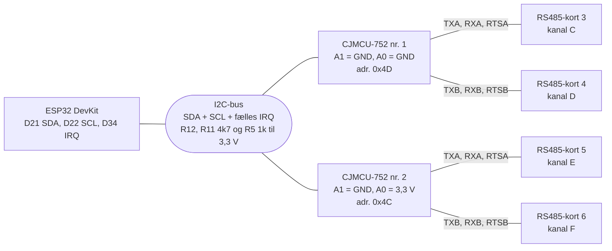

# Flere CJMCU-752 på samme I2C-bus: 6 kanaler (plan)

**Dette er en plan.** Firmwaren understøtter i dag kun ét CJMCU-752-modul (kanal C og D). Her vises et board med **to moduler** på samme I2C-bus (D21 og D22). Hvert modul giver to UART'er, så der kommer fire ekstra kanaler (C til F) oveni A og B på ESP32, i alt **6 kanaler**. To moduler er det, I2C-bussen realistisk kan klare ved 115200 baud med den nuværende aflæsning. Hver UART kører højst 115200 baud. Kanal E og F og port 506 og 507 er forslag. Det tegnede diagram står i [ESP32_FLERE_CJMCU752_KOBLING.html](ESP32_FLERE_CJMCU752_KOBLING.html). Resten af boardet (W5500, JP1, JP2, LED1 og LED2, watchdog-LED0, RS485-kort 1 og 2) er som i [variant 2](ESP32_W5500_UART_RS485_KOBLING.md).

## Kanaler, moduler og adresser

| Modul | I2C-adresse | A1 / A0 | RS485-kort | Kanaler | Modbus TCP-porte (forslag) |
|---|---|---|---|---|---|
| ESP32 (direkte) | - | - | 1 og 2 | A, B | 502, 503 |
| CJMCU-752 nr. 1 | 0x4D | GND / GND | 3 og 4 | C, D | 504, 505 |
| CJMCU-752 nr. 2 | 0x4C | GND / 3,3 V | 5 og 6 | E, F | 506, 507 |

Adresserne 0x49 (A1 = 3,3 V, A0 = GND) og 0x48 (begge på 3,3 V) er ledige til flere moduler senere.

## Forbindelser

| Fra | Til | Funktion |
|---|---|---|
| ESP32 D21 | SDA på begge moduler | I2C-data (fælles) |
| ESP32 D22 | SCL på begge moduler | I2C-clock (fælles) |
| ESP32 D34 | IRQ på begge moduler, og R5 1k til 3,3 V | Fælles afbrydelse (åben afløb, valgfri; bruges ikke af firmwaren i dag) |
| SDA og SCL | R12 og R11 4,7k til 3,3 V | Pull-ups for hele bussen |
| Modul nr. 1, A1 og A0 | GND | Adresse 0x4D |
| Modul nr. 2, A1 | GND | Adresse 0x4C |
| Modul nr. 2, A0 | 3,3 V | Adresse 0x4C |
| Hvert modul, TXA / RXA / RTSA | RS485-kortets DI / RO / DE + /RE | UART A (kanal C og E) |
| Hvert modul, TXB / RXB / RTSB | RS485-kortets DI / RO / DE + /RE | UART B (kanal D og F) |
| Hvert modul, VCC og GND | 3,3 V og GND | Forsyning |

På hvert RS485-kort forbindes DE og /RE med hinanden. Høj = sender, lav = modtager, og signalet kommer fra modulets RTS-ben. LED'er (chippens GPIO0 og GPIO1 via 1k) pr. modul forbindes som LED3 og LED4 i variant 2.

## Grænser

- **I2C-bussen (400 kHz) er den praktiske grænse ved 115200 baud.** Med den nuværende måde at aflæse chippen på (ca. hvert millisekund pr. kanal, mens den venter på svar) er **2 moduler (6 kanaler) realistisk**. Det er beregnet, ikke målt.
- **Flere end 2 moduler** kræver, at aflæsningen gøres smartere (se nedenfor). Så kan et tredje modul (adresse 0x49) give 8 kanaler, som er designets loft (port 502 til 509).
- **Adresser:** med A0 og A1 på kun GND eller 3,3 V er der 4 mulige moduler (0x48, 0x49, 0x4C, 0x4D), altså 8 UART'er. Lægges A0 og A1 også på SCL og SDA, er der 16 adresser (32 UART'er).
- **Pull-ups:** har CJMCU-printet egne pull-ups på SDA og SCL, ligger de i parallel med R12 og R11. Hvis hvert modul har 4,7 kΩ, giver R12 (eller R11) og to moduler tilsammen ca. 1,6 kΩ, hvilket er acceptabelt. Ved flere moduler skal pull-ups fjernes fra nogle af dem, så den samlede modstand ikke kommer under ca. 1 kΩ.

## Det skal ændres i firmwaren

- **Flere moduler (ny UART-chip):** i dag findes kun én global chip (`g_address`) og to porte. Der skal bruges en liste af SC16IS752-chips, hver med sin adresse (fundet ved at prøve 0x48 til 0x57) og sin egen skygge-kopi af IOSTATE.
- **LED-status:** kanal-LED'erne følger chippens GPIO0 og GPIO1 pr. modul (modul 1: kanal C/D, modul 2: kanal E/F), initialiseret pr. chip ved start. Watchdog-LED'en på GPIO2 (v0.37.0, 1 blink i sekundet) er allerede implementeret; blinker den ikke, hænger hovedløkken.
- **Kanaler:** kanal-ID'er og konfiguration udvides fra 4 til 6 pladser. Det er klogt at gå direkte til 8 (designets loft), så et tredje modul senere ikke kræver endnu en konfigurationsversion. Der skal være migrering af gemt konfiguration. Modbus TCP-porte 504 til 507, REST (`/api/channels/1` til `6`) og CLI (`test 1-6`, `debug modbus a-f`).
- **Aflæsning:** brug chippens FIFO-trigger og den fælles IRQ-linje i stedet for at spørge hvert millisekund, og læs længere stykker ad gangen, så bussen ikke bliver fyldt, og 64-bytes-bufferen ikke løber over ved lange svar.
- **Status og PLC:** `board_type` og antal aktive kanaler (op til 6) i `/api/status`, og PLC'en skal kunne vise kanal E og F.
