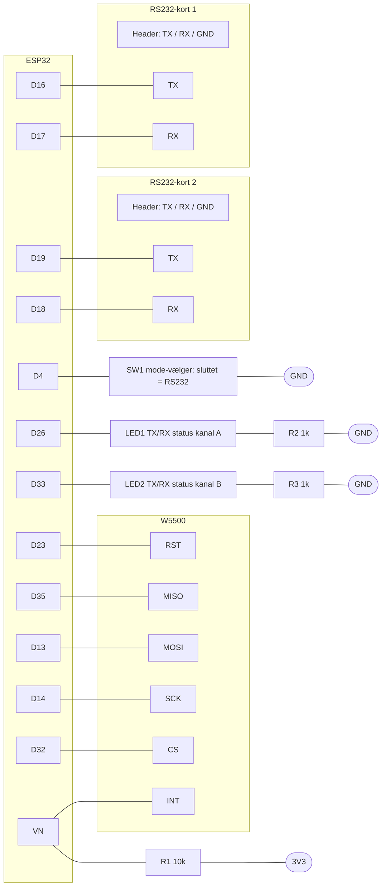

# ESP32 med W5500 og to RS232-kort

Alle komponenter forsynes med 3,3 V. Strøm ind: 3,3 V til VCC, GND til GND.

## Diagram

## Forbindelser

| Fra | Til | Funktion |
|---|---|---|
| Strøm ind 3,3 V | VCC på ESP32, W5500, RS232-kort 1 og 2 | Forsyning |
| Strøm ind GND | GND på ESP32, W5500, RS232-kort 1 og 2 | Stel |
| ESP32 D16 | RS232-kort 1 TX | UART |
| ESP32 D17 | RS232-kort 1 RX | UART |
| ESP32 D19 | RS232-kort 2 TX | UART |
| ESP32 D18 | RS232-kort 2 RX | UART |
| ESP32 D23 | W5500 RST | Reset |
| ESP32 D35 | W5500 MISO | SPI (indgang) |
| ESP32 D13 | W5500 MOSI | SPI (udgang) |
| ESP32 D14 | W5500 SCK | SPI (clock) |
| ESP32 D32 | W5500 CS | SPI (chip select) |
| ESP32 VN | W5500 INT | Afbrydelse fra W5500 |
| ESP32 VN | R1 10k | Pull-up |
| ESP32 3V3 | R1 10k | Pull-up til 3,3 V |
| ESP32 D4 | SW1 | Mode-vælger (RS232/RS485) |
| ESP32 GND | SW1 | Mode-vælger (RS232/RS485) |
| ESP32 D26 | LED1 → R2 1k → GND | TX/RX-status kanal A |
| ESP32 D33 | LED2 → R3 1k → GND | TX/RX-status kanal B |

## RS232-kortenes header

Hvert RS232-kort har en header til RS232-siden med tre ben: TX, RX og GND.

## Bemærkninger

- R1 trækker INT på VN op til 3,3 V, så linjen er høj når W5500 ikke melder noget.
- SW1 er mode-vælger for boardet: sluttet (D4 lav) = RS232-mode, åben (D4 høj) = RS485-mode.
- LED1 viser TX/RX-status for kanal A (RS232-kort 1). LED2 viser TX/RX-status for kanal B (RS232-kort 2).
- D35 er kun indgang på ESP32, og passer til MISO.
