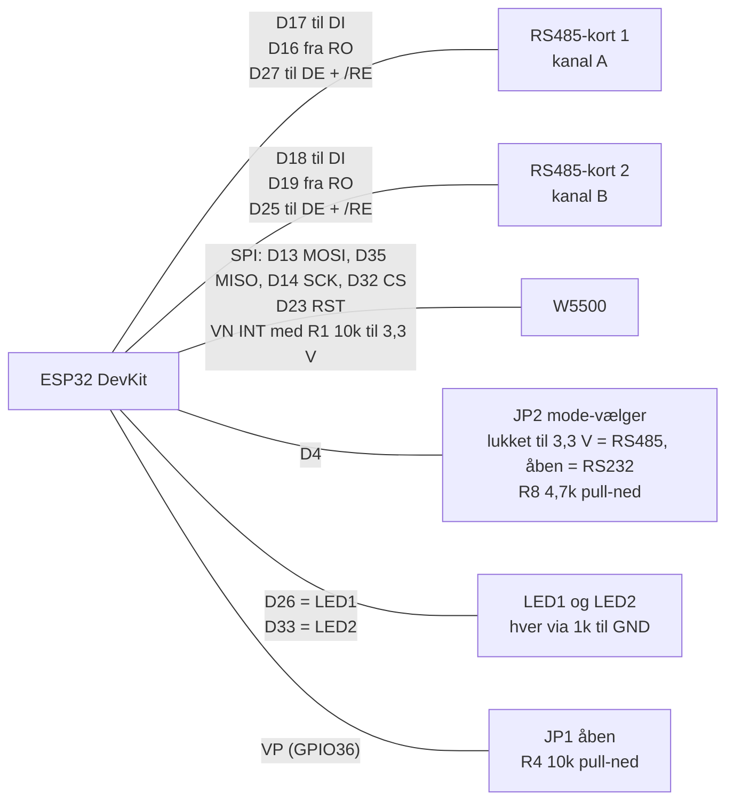
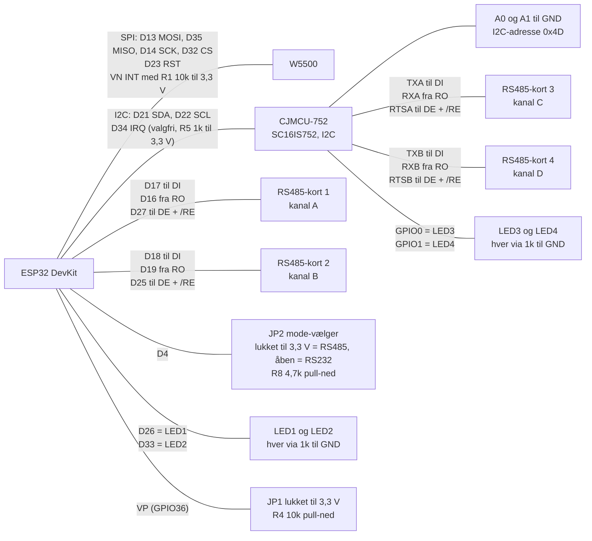
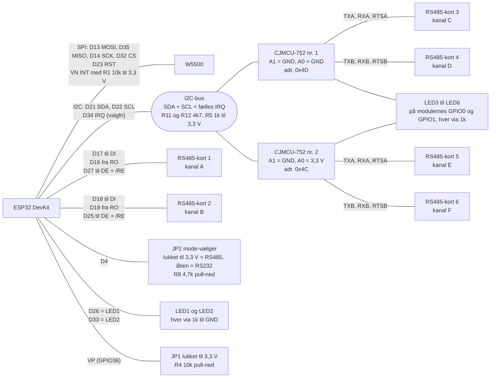

# ESP32 med W5500 og RS485-kort: varianter af samme board

Det er samme print. **Variant 1** har 2 kanaler (A og B). **Variant 2** har desuden et CJMCU-752-modul (SC16IS752, 2 × UART over I2C) og to RS485-kort mere, så boardet får 4 kanaler (A til D). **Variant 3** er en **plan** med to CJMCU-752 på samme I2C-bus, så boardet får 6 kanaler (A til F); den kræver en ændret firmware. Alle komponenter forsynes med 3,3 V. Strøm ind: 3,3 V til VCC, GND til GND. Se også [GPIO_MAPPING.md](../GPIO_MAPPING.md) og det tegnede diagram i [ESP32_W5500_UART_RS485_KOBLING.html](ESP32_W5500_UART_RS485_KOBLING.html).

## Forskel på varianterne

| | Variant 1 | Variant 2 | Variant 3 (plan) |
|---|---|---|---|
| Kanaler | 2 (A, B) | 4 (A til D) | 6 (A til F) |
| Modbus TCP-porte | 502, 503 | 502 til 505 | 502 til 507 (E og F er forslag) |
| Boardtype i `/api/status` | `2xRS485` | `4xRS485` | `6xRS485` (forslag) |
| RS485-kort | 1 og 2, direkte på ESP32 | 1 og 2 direkte på ESP32, 3 og 4 på CJMCU-752 | 1 og 2 direkte på ESP32, 3 og 4 på CJMCU-752 nr. 1, 5 og 6 på nr. 2 |
| CJMCU-752 (I2C på D21 og D22) | ikke monteret | ét modul, A0 og A1 på GND (adresse 0x4D) | to moduler: 0x4D (A1 = GND, A0 = GND) og 0x4C (A1 = GND, A0 = 3,3 V) |
| JP1 (EXP_SEL på VP / GPIO36) | åben | lukket (til 3,3 V) | lukket (til 3,3 V) |
| JP2 (mode på D4) | lukket = RS485, åben = RS232 | lukket = RS485, åben = RS232 | lukket = RS485, åben = RS232 |
| Aktivitets-LED'er | LED1 og LED2 på ESP32 | LED1 og LED2 på ESP32, LED3 og LED4 på CJMCU-752 | LED1 og LED2 på ESP32, LED3 til LED6 på de to CJMCU-752 |
| Firmware | samme | samme | **kræver ændret firmware** (i dag kun ét modul) |

## Variant 1: 2 kanaler

## Variant 2: 4 kanaler med CJMCU-752

## Variant 3: 6 kanaler med to CJMCU-752 (plan)

**Dette er en plan.** To moduler er det, I2C-bussen realistisk kan klare ved 115200 baud med den nuværende aflæsning (beregnet, ikke målt). Kanal E og F og port 506 og 507 er forslag.

## Forbindelser (fælles for alle varianter)

| Fra | Til | Funktion |
|---|---|---|
| Strøm ind 3,3 V | VCC på ESP32, W5500 og alle RS485-kort (samt CJMCU-752 i variant 2 og 3) | Forsyning |
| Strøm ind GND | GND på alt | Stel |
| ESP32 D17 | RS485-kort 1 DI | UART TX, kanal A |
| RS485-kort 1 RO | ESP32 D16 | UART RX, kanal A |
| ESP32 D27 | RS485-kort 1 DE og /RE (samme ledning) | Retning, kanal A |
| ESP32 D18 | RS485-kort 2 DI | UART TX, kanal B |
| RS485-kort 2 RO | ESP32 D19 | UART RX, kanal B |
| ESP32 D25 | RS485-kort 2 DE og /RE (samme ledning) | Retning, kanal B |
| ESP32 D23 | W5500 RST | Reset |
| ESP32 D35 | W5500 MISO | SPI (indgang) |
| ESP32 D13 | W5500 MOSI | SPI (udgang) |
| ESP32 D14 | W5500 SCK | SPI (clock) |
| ESP32 D32 | W5500 CS | SPI (chip select) |
| ESP32 VN | W5500 INT og R1 10k til 3,3 V | Afbrydelse fra W5500 med pull-up |
| ESP32 D4 | JP2 til 3,3 V, og R8 4,7k til GND | Mode-vælger: lukket = RS485, åben = RS232 |
| ESP32 D26 | LED1, R2 1k, GND | Aktivitet kanal A |
| ESP32 D33 | LED2, R3 1k, GND | Aktivitet kanal B |
| ESP32 VP (GPIO36) | R4 10k til GND, og JP1 til 3,3 V | EXP_SEL: JP1 lukket = CJMCU-752 monteret |

## Ekstra forbindelser i variant 2 (CJMCU-752)

| Fra | Til | Funktion |
|---|---|---|
| ESP32 D21 | CJMCU-752 SDA | I2C-data |
| ESP32 D22 | CJMCU-752 SCL | I2C-clock |
| ESP32 D34 | CJMCU-752 IRQ og R5 1k til 3,3 V | Valgfri, bruges ikke af firmwaren |
| CJMCU-752 A0 | GND | I2C-adresse (sammen med A1: 0x4D) |
| CJMCU-752 A1 | GND | I2C-adresse (sammen med A0: 0x4D) |
| CJMCU-752 TXA | RS485-kort 3 DI | UART TX, kanal C |
| RS485-kort 3 RO | CJMCU-752 RXA | UART RX, kanal C |
| CJMCU-752 RTSA | RS485-kort 3 DE og /RE (samme ledning) | Retning, kanal C (styres af chippen) |
| CJMCU-752 TXB | RS485-kort 4 DI | UART TX, kanal D |
| RS485-kort 4 RO | CJMCU-752 RXB | UART RX, kanal D |
| CJMCU-752 RTSB | RS485-kort 4 DE og /RE (samme ledning) | Retning, kanal D (styres af chippen) |
| CJMCU-752 GPIO0 | LED3, R6 1k, GND | Aktivitet kanal C |
| CJMCU-752 GPIO1 | LED4, R7 1k, GND | Aktivitet kanal D |

## Ekstra forbindelser i variant 3 (to CJMCU-752, plan)

Variant 3 bygger på variant 2, men to moduler deler I2C-bussen.

| Fra | Til | Funktion |
|---|---|---|
| ESP32 D21 | SDA på begge moduler | I2C-data (fælles) |
| ESP32 D22 | SCL på begge moduler | I2C-clock (fælles) |
| ESP32 D34 | IRQ på begge moduler, og R5 1k til 3,3 V | Fælles afbrydelse (åben afløb, valgfri; bruges ikke af firmwaren i dag) |
| SDA og SCL | R12 og R11 4,7k til 3,3 V | Pull-ups for hele bussen, for enden af den |
| Modul nr. 1, A1 og A0 | GND | Adresse 0x4D |
| Modul nr. 2, A1 | GND | Adresse 0x4C |
| Modul nr. 2, A0 | 3,3 V | Adresse 0x4C |
| Modul nr. 1, TXA / RXA / RTSA | RS485-kort 3 DI / RO / DE + /RE | UART A, kanal C |
| Modul nr. 1, TXB / RXB / RTSB | RS485-kort 4 DI / RO / DE + /RE | UART B, kanal D |
| Modul nr. 2, TXA / RXA / RTSA | RS485-kort 5 DI / RO / DE + /RE | UART A, kanal E |
| Modul nr. 2, TXB / RXB / RTSB | RS485-kort 6 DI / RO / DE + /RE | UART B, kanal F |
| Modul nr. 1, GPIO0 og GPIO1 | LED3 og LED4, R6 og R7 1k, GND | Aktivitet kanal C og D |
| Modul nr. 2, GPIO0 og GPIO1 | LED5 og LED6, R9 og R10 1k, GND | Aktivitet kanal E og F |
| Hvert modul, VCC og GND | 3,3 V og GND | Forsyning |

**Grænser:** med A0 og A1 på kun GND eller 3,3 V er der 4 mulige moduler (0x48, 0x49, 0x4C, 0x4D). Mere end 2 moduler kræver, at aflæsningen gøres smartere. Har CJMCU-printet egne pull-ups, ligger de i parallel med R11 og R12: hvis hvert modul har 4,7 kΩ, giver R12 (eller R11) og to moduler tilsammen ca. 1,6 kΩ, hvilket er acceptabelt; ved flere moduler skal pull-ups fjernes fra nogle af dem.

**Det skal ændres i firmwaren:**

- **Flere moduler (ny UART-chip):** en liste af SC16IS752-chips, hver med sin adresse (fundet ved at prøve 0x48 til 0x57) og egen IOSTATE-skygge, i stedet for én global chip.
- **LED-status:** kanal-LED'erne følger chippens GPIO0/GPIO1 pr. modul (kanal C til F), initialiseret pr. chip ved start. Watchdog-LED'en på GPIO2 (v0.37.0, 1 blink i sekundet) er allerede implementeret.
- **Kanaler:** kanal-ID'er og konfiguration fra 4 til 6 pladser (klogt: direkte til 8), med migrering af gemt konfiguration; Modbus TCP-porte 504 til 507, REST (`/api/channels/1` til `6`) og CLI (`test 1-6`, `debug modbus a-f`).
- **Aflæsning:** chippens FIFO-trigger og den fælles IRQ-linje i stedet for at spørge hvert millisekund; nødvendigt ved flere end to moduler.
- **Status og PLC:** `board_type` og antal aktive kanaler (op til 6) i `/api/status`; PLC'en skal kunne vise kanal E og F.

## Bemærkninger

- På hvert RS485-kort forbindes DE og /RE med hinanden og går til ét signal. Høj = sender, lav = modtager. **Bind ikke /RE til GND**, ellers hører kortet sin egen afsendelse.
- Retningen styres af ESP32 (D27, D25) for kanal A og B, og af CJMCU-752's RTS-ben for kanal C og D.
- JP2 skal være lukket (D4 høj) med RS485-kort; åben giver RS232 (R8 trækker D4 lavt). Firmwaren har ESP32'ens interne pull-up (ca. 45 kΩ) slået til på D4, så R8 er 4,7 kΩ: det giver et sikkert lavt niveau, når JP2 er åben. I RS232-mode rører firmwaren aldrig retningen.
- R4 trækker VP (GPIO36) lavt. GPIO34-39 har ingen intern pull, så modstanden er nødvendig i begge varianter.
- R1 trækker INT på VN op til 3,3 V. D35 er kun indgang på ESP32 og passer til MISO.
- SDA og SCL skal have pull-ups til 3,3 V (typisk 4,7 kΩ); tjek om CJMCU-modulet har dem. IRQ kræver 1 kΩ til 3,3 V, hvis den forbindes.
- Brug 3,3 V-RS485-moduler (SP3485/MAX3485) og 120 Ω terminering i begge ender af hver bus.
