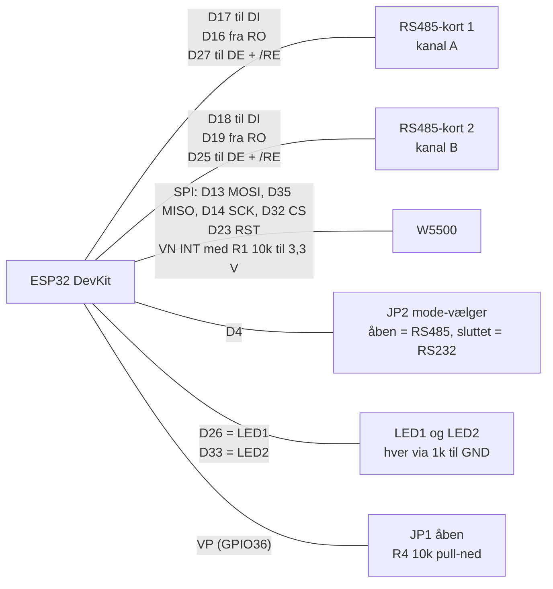
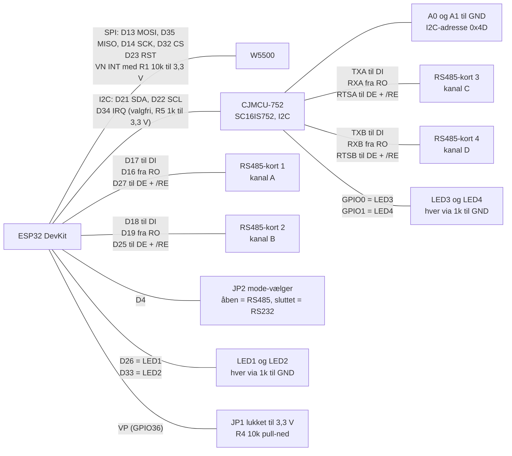

# ESP32 med W5500 og RS485-kort: to varianter af samme board

Det er samme print og samme firmware. **Variant 1** har 2 kanaler (A og B). **Variant 2** har desuden et CJMCU-752-modul (SC16IS752, 2 × UART over I2C) og to RS485-kort mere, så boardet får 4 kanaler (A til D). Alle komponenter forsynes med 3,3 V. Strøm ind: 3,3 V til VCC, GND til GND. Se også [GPIO_MAPPING.md](../GPIO_MAPPING.md) og det tegnede diagram i [ESP32_W5500_UART_RS485_KOBLING.html](ESP32_W5500_UART_RS485_KOBLING.html).

## Forskel på de to varianter

| | Variant 1 | Variant 2 |
|---|---|---|
| Kanaler | 2 (A, B) | 4 (A, B, C, D) |
| Modbus TCP-porte | 502, 503 | 502, 503, 504, 505 |
| Boardtype i `/api/status` | `2xRS485` | `4xRS485` |
| RS485-kort | 1 og 2, direkte på ESP32 | 1 og 2 direkte på ESP32, 3 og 4 på CJMCU-752 |
| CJMCU-752 (I2C på D21 og D22) | ikke monteret | monteret, A0 og A1 på GND (I2C-adresse 0x4D) |
| JP1 (EXP_SEL på VP / GPIO36) | åben | lukket (til 3,3 V) |
| Aktivitets-LED'er | LED1 og LED2 på ESP32 | LED1 og LED2 på ESP32, LED3 og LED4 på CJMCU-752 |
| Firmware | samme | samme |

## Variant 1: 2 kanaler

## Variant 2: 4 kanaler med CJMCU-752

## Forbindelser (fælles for begge varianter)

| Fra | Til | Funktion |
|---|---|---|
| Strøm ind 3,3 V | VCC på ESP32, W5500 og alle RS485-kort (samt CJMCU-752 i variant 2) | Forsyning |
| Strøm ind GND | GND på alt | Stel |
| ESP32 D17 | RS485-kort 1 DI | UART TX, kanal A |
| RS485-kort 1 RO | ESP32 D16 | UART RX, kanal A |
| ESP32 D27 | RS485-kort 1 DE og /RE (samme ledning) | Retning, kanal A |
| ESP32 D18 | RS485-kort 2 DI | UART TX, kanal B |
| RS485-kort 2 RO | ESP32 D19 | UART RX, kanal B |
| ESP32 D25 | RS485-kort 2 DE og /RE (samme ledning) | Retning, kanal B |
| ESP32 D23 | W5500 RST | Reset |
| ESP32 D35 | W5500 MISO | SPI (indgang) |
| ESP32 D13 | W5500 MOSI | SPI (udgang) |
| ESP32 D14 | W5500 SCK | SPI (clock) |
| ESP32 D32 | W5500 CS | SPI (chip select) |
| ESP32 VN | W5500 INT og R1 10k til 3,3 V | Afbrydelse fra W5500 med pull-up |
| ESP32 D4 | JP2 til GND | Mode-vælger: åben = RS485, sluttet = RS232 |
| ESP32 D26 | LED1, R2 1k, GND | Aktivitet kanal A |
| ESP32 D33 | LED2, R3 1k, GND | Aktivitet kanal B |
| ESP32 VP (GPIO36) | R4 10k til GND, og JP1 til 3,3 V | EXP_SEL: JP1 lukket = CJMCU-752 monteret |

## Ekstra forbindelser i variant 2 (CJMCU-752)

| Fra | Til | Funktion |
|---|---|---|
| ESP32 D21 | CJMCU-752 SDA | I2C-data |
| ESP32 D22 | CJMCU-752 SCL | I2C-clock |
| ESP32 D34 | CJMCU-752 IRQ og R5 1k til 3,3 V | Valgfri, bruges ikke af firmwaren |
| CJMCU-752 A0 | GND | I2C-adresse (sammen med A1: 0x4D) |
| CJMCU-752 A1 | GND | I2C-adresse (sammen med A0: 0x4D) |
| CJMCU-752 TXA | RS485-kort 3 DI | UART TX, kanal C |
| RS485-kort 3 RO | CJMCU-752 RXA | UART RX, kanal C |
| CJMCU-752 RTSA | RS485-kort 3 DE og /RE (samme ledning) | Retning, kanal C (styres af chippen) |
| CJMCU-752 TXB | RS485-kort 4 DI | UART TX, kanal D |
| RS485-kort 4 RO | CJMCU-752 RXB | UART RX, kanal D |
| CJMCU-752 RTSB | RS485-kort 4 DE og /RE (samme ledning) | Retning, kanal D (styres af chippen) |
| CJMCU-752 GPIO0 | LED3, R6 1k, GND | Aktivitet kanal C |
| CJMCU-752 GPIO1 | LED4, R7 1k, GND | Aktivitet kanal D |

## Bemærkninger

- På hvert RS485-kort forbindes DE og /RE med hinanden og går til ét signal. Høj = sender, lav = modtager. **Bind ikke /RE til GND**, ellers hører kortet sin egen afsendelse.
- Retningen styres af ESP32 (D27, D25) for kanal A og B, og af CJMCU-752's RTS-ben for kanal C og D.
- JP2 skal være åben (D4 høj) med RS485-kort. I RS232-mode rører firmwaren aldrig retningen.
- R4 trækker VP (GPIO36) lavt. GPIO34-39 har ingen intern pull, så modstanden er nødvendig i begge varianter.
- R1 trækker INT på VN op til 3,3 V. D35 er kun indgang på ESP32 og passer til MISO.
- SDA og SCL skal have pull-ups til 3,3 V (typisk 4,7 kΩ); tjek om CJMCU-modulet har dem. IRQ kræver 1 kΩ til 3,3 V, hvis den forbindes.
- Brug 3,3 V-RS485-moduler (SP3485/MAX3485) og 120 Ω terminering i begge ender af hver bus.
